<div align="center">


🚗 Smart Parking System
A production-grade REST API that allocates, prices and manages parking — automatically.

<sub>Slot allocation  •  JWT + RBAC  •  Surge pricing  •  Pessimistic locking  •  Admin analytics</sub>


Overview  · 
Features  · 
Architecture  · 
Core Flows  · 
API  · 
Quick Start  · 
Dockerization
</div>
<table align="center">
<tr>
<td align="center" width="25%"><h2>3</h2><sub>Vehicle types<br/>CAR · BIKE · AUTO</sub></td>
<td align="center" width="25%"><h2>2</h2><sub>Roles<br/>USER · ADMIN</sub></td>
<td align="center" width="25%"><h2>11</h2><sub>REST endpoints</sub></td>
<td align="center" width="25%"><h2>0</h2><sub>Double-booked slots<br/>by design</sub></td>
</tr>
</table>📑 Table of Contents
<details>
<summary><b>Click to expand</b></summary>
1. Overview
2. Feature Highlights
3. Architecture
4. Core Flows
5. Pricing Engine
6. Concurrency Control
7. Admin Analytics
8. Database Model
9. API Reference
10. Project Structure
11. Tech Stack
12. Quick Start
13. Dockerization
14. Roadmap
15. Author
16. Roadmap
17. Author
</details>🎯 Overview
Smart Parking System is not a CRUD demo. It is a backend built around the problems real parking platforms actually face — security, fairness under concurrency, pricing and observability.

	Real-world question	How this project answers it
🔐	How do we protect APIs without server sessions?	Stateless JWT + Spring Security + RBAC
🅿️	Who picks the slot?	The backend — vehicle-type based automatic allocation
⚡	What if two users grab the last slot at once?	@Transactional + PESSIMISTIC_WRITE locking
💰	How should price react to demand?	DB-backed rates + occupancy-based surge multiplier
🔄	How do entry and exit affect state?	Synchronized booking & slot state machines
📊	How do admins see utilization and revenue?	Dedicated analytics services and APIs
🧩	How do we keep API and DB models decoupled?	DTOs + MapStruct


[!NOTE]
This repository contains the backend only. The frontend is maintained separately.

✨ Feature Highlights
<table>
<tr>
<td width="50%" valign="top">🔐 Security
JWT authentication, BCrypt password hashing, method-level @PreAuthorize, role-based access and ownership validation.
🅿️ Smart Allocation
Users never choose a slot. The system finds and locks a matching AVAILABLE slot for the vehicle type.
📋 Booking Lifecycle
Entry, exit and paginated history, with booking and slot states always kept in sync.
💰 Dynamic Pricing
Rates live in the database. A surge multiplier is computed from occupancy and locked at entry.
</td>
<td width="50%" valign="top">⚡ Concurrency Safe
Database-level pessimistic locking guarantees a slot is never assigned twice.
📊 Admin Analytics
Occupancy, booking and revenue insights, including vehicle-type-wise slot stats.
🧩 Clean API Design
Entities are never exposed. Request/response DTOs are mapped with MapStruct.
🛡️ Robust Errors
Jakarta Bean Validation and a centralized @RestControllerAdvice with consistent error responses.
</td>
</tr>
</table>🏗️ Architecture
A clean, layered architecture with clear responsibilities per layer.
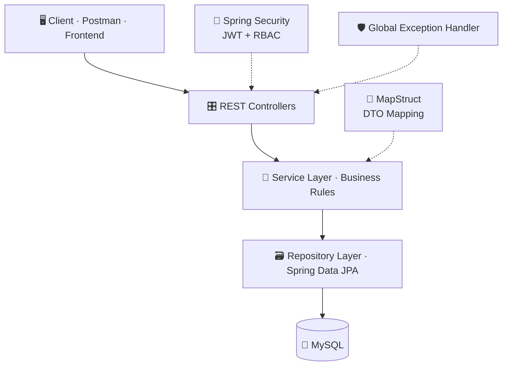
<details>
<summary><b>📥 Request processing pipeline</b></summary>
HTTP Request
   → Spring Security
   → JWT Validation
   → Authentication / Authorization
   → Controller
   → DTO Validation
   → Service (Business Rules)
   → Transaction
   → Repository
   → MySQL
   → Entity
   → MapStruct
   → Response DTO
   → HTTP Response
</details>🧩 DTO & Mapping Strategy
Entities are never exposed through REST APIs.
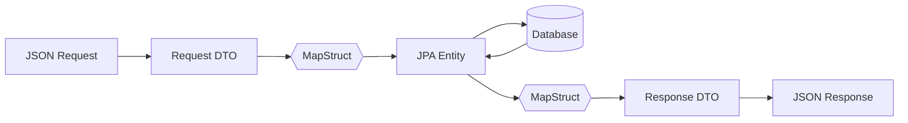
Benefit	Why it matters
Clean API contracts	Clients depend on DTOs, not on table structure
Decoupled models	DB schema can evolve without breaking the API
Less boilerplate	MapStruct generates mappers at compile time
Maintainability	One place to change a mapping


🛡️ Validation & Exception Handling
Jakarta Bean Validation with centralized handling through @RestControllerAdvice.
✅ Validated	🚨 Handled scenarios
Required fields, email, password	Validation errors
Phone number, vehicle number	Resource not found · duplicate resources
Parking slot data, parking rates	Unauthorized actions · slot unavailable
	Authentication failures · access denied · runtime exceptions


🔄 Core Flows
🔐 Authentication
Stateless JWT authentication with Spring Security.
Capabilities: registration & login · BCrypt hashing · JWT generation & validation · custom UserDetailsService · JWT authentication filter · USER / ADMIN roles · method-level security with @PreAuthorize · ownership validation

Phase 1 — Login (token generation)
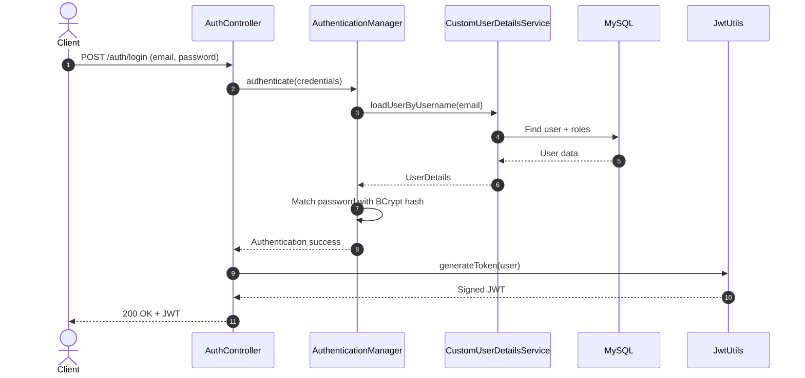
Phase 2 — Accessing a protected API
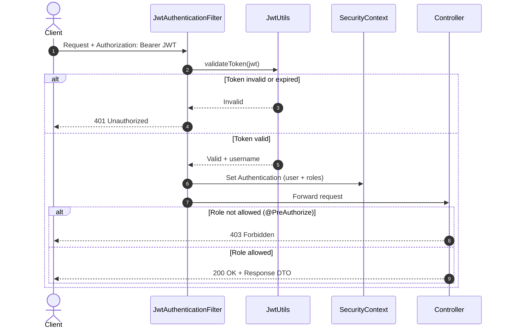
🅿️ Intelligent Slot Allocation
Users do not select a slot manually. The backend finds an available slot that matches the vehicle type.
Vehicle	Enum
🚗 Car	CAR
🏍️ Bike	BIKE
🛺 Auto	AUTO


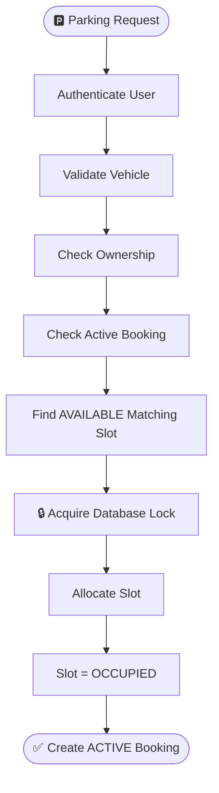
📋 Booking & Slot Lifecycle
Booking state and slot state are always kept synchronized.
<table>
<tr>
<td width="50%" valign="top">
Booking states
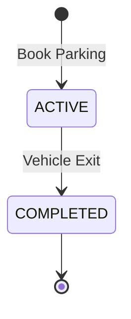
</td>
<td width="50%" valign="top">Slot states
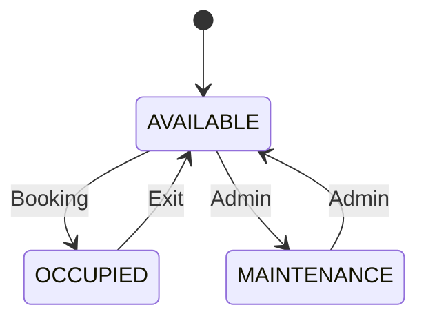
</td>
</tr>
</table>🚪 Exit & Billing
Step	Action
1	Find the user's ACTIVE booking and verify ownership
2	Record exit time and calculate duration
3	Apply minimum one-hour billing
4	Apply the booking's locked surge multiplier
5	Calculate the final amount
6	Mark booking COMPLETED and release the slot


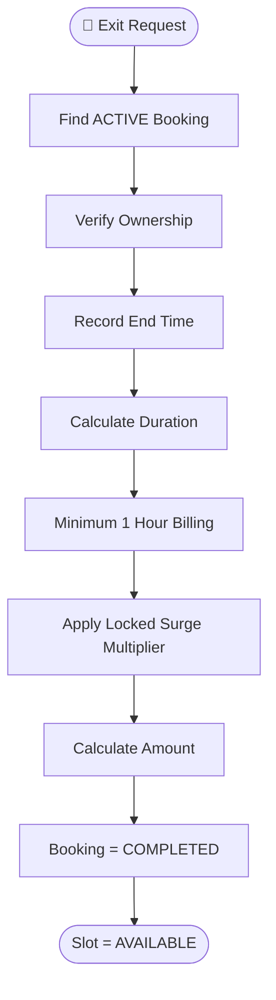
📄 Booking History
Users can retrieve their own bookings with pagination, sorting and DTO-based responses.
GET /booking/my-bookings?page=0&size=10&sort=startTime,desc
GET /booking/my-bookings?page=0&size=5&sort=amount,desc
{
  "content": [],
  "page": 0,
  "size": 10,
  "totalElements": 25,
  "totalPages": 3
}
💰 Pricing Engine
Rates are stored in the database, not hardcoded in booking logic, and are managed independently through admin APIs.
Vehicle	Base rate
🏍️ Bike	₹20 / hour
🛺 Auto	₹30 / hour
🚗 Car	₹50 / hour


⚡ Surge Pricing
A surge multiplier is calculated from current parking occupancy and locked into the booking at entry, so the pricing basis stays consistent until exit.
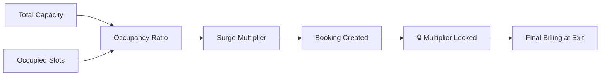
[!TIP]
Locking the multiplier at entry means a driver is never charged more because the lot filled up after they arrived.

⚡ Concurrency Control
What happens if multiple users request the last available slot at almost the same time?

Slot allocation is protected with @Transactional, PESSIMISTIC_WRITE, database-level locking and atomic slot state updates — the same slot is never assigned to concurrent requests.
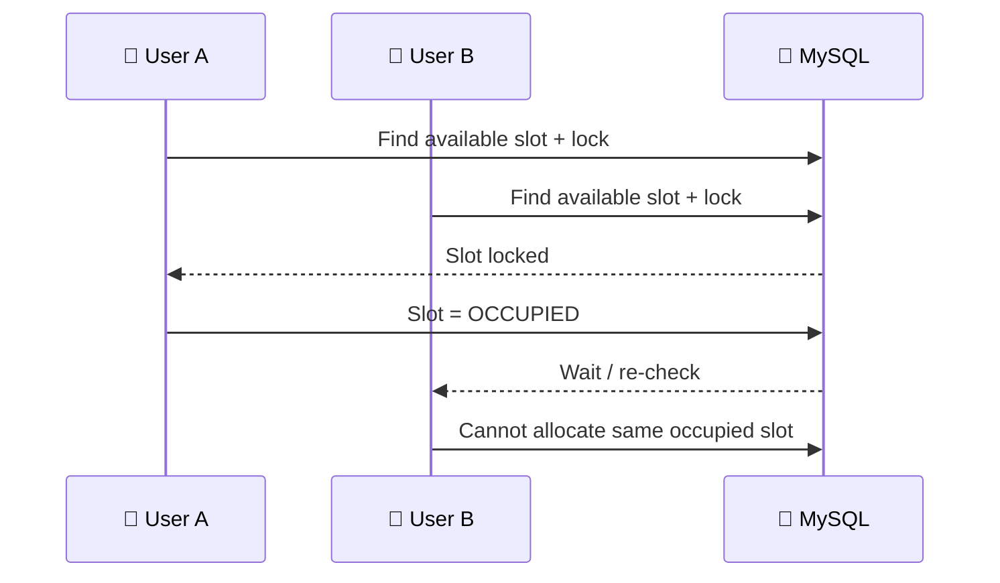
Mechanism	Purpose
@Transactional	Keeps the allocation atomic
PESSIMISTIC_WRITE	Blocks competing requests on the same row
Atomic state update	Slot and booking change together or not at all


📊 Admin Analytics
<table>
<tr>
<td width="50%" valign="top">🅿️ Parking analytics
- Total slots
- Available slots
- Occupied slots
- Maintenance slots
- Overall occupancy %
- Vehicle-type-wise slot stats
</td>
<td width="50%" valign="top">📋 Booking analytics
- Total bookings
- Active bookings
- Completed bookings
- Total completed revenue
</td>
</tr>
</table>```mermaid
flowchart LR
    A[("Parking Slots")] --> C["📊 Analytics Service"]
    B[("Bookings")] --> C
    C --> D["Occupancy Analytics"]
    C --> E["Booking Analytics"]
    C --> F["Revenue Analytics"]
    D --> G(["🛡️ Admin API"])
    E --> G
    F --> G
```
🗄️ Database Model
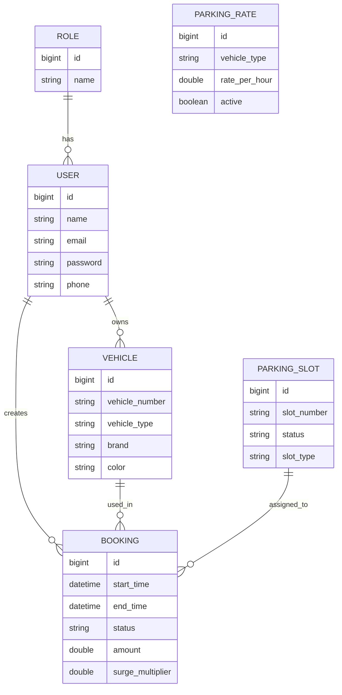
🌐 API Reference
All protected endpoints require:
Authorization: Bearer <JWT_TOKEN>
Module	Method	Endpoint	Access
🔐 Auth		/auth/register	🌍 Public
🔐 Auth		/auth/login	🌍 Public
🚘 Vehicle		/vehicle/saveVehicle	🔒 User
🅿️ Slots		/parkingslot/register	🛡️ Admin
📋 Booking		/booking/book	🔒 User
📋 Booking		/booking/exit	🔒 User
📋 Booking		/booking/my-bookings	🔒 User
💰 Rates		/parking-rates	🔑 Authenticated
💰 Rates		/parking-rates/{vehicleType}	🛡️ Admin
📊 Analytics		/admin/parking/analytics	🛡️ Admin
📊 Analytics		/admin/parking/booking-analytics	🛡️ Admin


<sub>🌍 Public  ·  🔑 Any authenticated user  ·  🔒 Role USER  ·  🛡️ Role ADMIN</sub>
🗂️ Project Structure
<details>
<summary><b>Click to expand</b></summary>src/main/java/com/sahil/smart_parking_project
│
├── controller
│   ├── AuthController
│   ├── VehicleController
│   ├── ParkingSlotController
│   ├── ParkingBookingController
│   ├── ParkingRateController
│   ├── AdminAnalyticsController
│   └── AdminBookingAnalyticsController
│
├── service
│   ├── AuthService
│   ├── ParkingSlotBookingService
│   ├── ParkingSlotService
│   ├── VehicleService
│   ├── ParkingRateService
│   ├── ParkingAnalyticsService
│   └── ParkingBookingAnalyticsService
│
├── repository
│   ├── UserRepository
│   ├── VehicleRepository
│   ├── ParkingSlotRepository
│   ├── BookingRepository
│   ├── ParkingRateRepository
│   └── RoleRepository
│
├── entity
│   ├── User · Role · Vehicle
│   └── ParkingSlot · Booking · ParkingRate
│
├── dto
│   ├── Auth · Booking · Vehicle DTOs
│   ├── Parking Slot · Parking Rate DTOs
│   ├── Analytics DTOs
│   └── PageResponseDTO
│
├── security
│   ├── JwtUtils
│   ├── JwtAuthenticationFilter
│   ├── CustomUserDetailsService
│   └── SmartParkingSpringSecurity
│
├── map_struct
│   ├── UserMapper · VehicleMapper · BookingMapper
│   └── ParkingSlotMapper · ParkingRateMapper
│
├── globalException
│   ├── GlobalExceptionHandler · ErrorResponse
│   ├── ResourceNotFoundException · UnauthorizedActionException
│   └── SlotUnavailableException · DuplicateResourceException
│
├── enums
│   └── RoleType · VehicleType · SlotStatus · BookingStatus
│
└── util
    └── ParkingBookingSlotUtil
</details>🛠️ Tech Stack
Layer	Technologies
⚙️ Backend	Java · Spring Boot · Spring Security · Spring Data JPA · Hibernate
🔌 API & Auth	REST · JWT · BCrypt · Jakarta Validation
🧩 Mapping	MapStruct
🗄️ Database	MySQL
🧰 Tooling	Maven · Git & GitHub · Postman · Eclipse / Spring Tool Suite
🐳 Containerization	Docker · Docker Image · Docker Container · Docker Network · Docker Volume · Docker Compose


🚀 Quick Start
✅ Prerequisites
Requirement	Version
☕ Java	21+
🐬 MySQL	8.x
📦 Maven	Wrapper included (mvnw)
🐳 Docker	Docker Desktop / Docker Engine


1️⃣ Clone the repository
git clone https://github.com/Sahil2u47/smart_parking_system.git
cd smart_parking_system
2️⃣ Create the database
CREATE DATABASE smart_parkingdb;
3️⃣ Configure environment variables
DB_USERNAME=your_database_username
DB_PASSWORD=your_database_password
JWT_SECRET=your_long_secure_jwt_secret
[!WARNING]
Never commit real credentials or your JWT_SECRET. Use a long, random secret in every environment.

4️⃣ Run the application
# Linux / macOS
./mvnw spring-boot:run

# Windows
mvnw.cmd spring-boot:run
🎉 The backend is now live at http://localhost:8182
🔒 Security Model
Rule	Detail
Session policy	Stateless via SessionCreationPolicy.STATELESS
Public routes	/auth/**
Everything else	Requires a valid JWT and, where applicable, the correct role


🐳 Dockerization
The backend is containerized so it can run in a consistent, isolated environment instead of depending entirely on the Java and build-tool setup of the host machine.

The Docker setup is focused on the Spring Boot backend and MySQL database only. The frontend is maintained in a separate repository and is intentionally not documented here.
🎯 Why Dockerization?
Running an application directly on a developer's machine can create environment-related differences: Java versions, installed tools, database setup and local configuration may vary from one machine to another.

Docker helps make the backend deployment more predictable by packaging the application and its runtime environment into an image.
Challenge without Docker	How Docker helps
Different Java/runtime setups across machines	The backend runs inside a container with its required runtime
Manual application setup on every machine	A built image can be reused to create containers
Backend and database need separate environments	Backend and MySQL can run as independent containers
Containers need to communicate	A Docker network provides container-to-container communication
Database data must survive container recreation	A Docker volume stores MySQL data outside the container's writable layer
Multiple services need coordinated startup	Docker Compose can define and manage the services together


🏗️ Container Architecture
The backend application and database run as separate services. The backend communicates with MySQL over a Docker network, while the database stores its persistent files in a Docker volume.
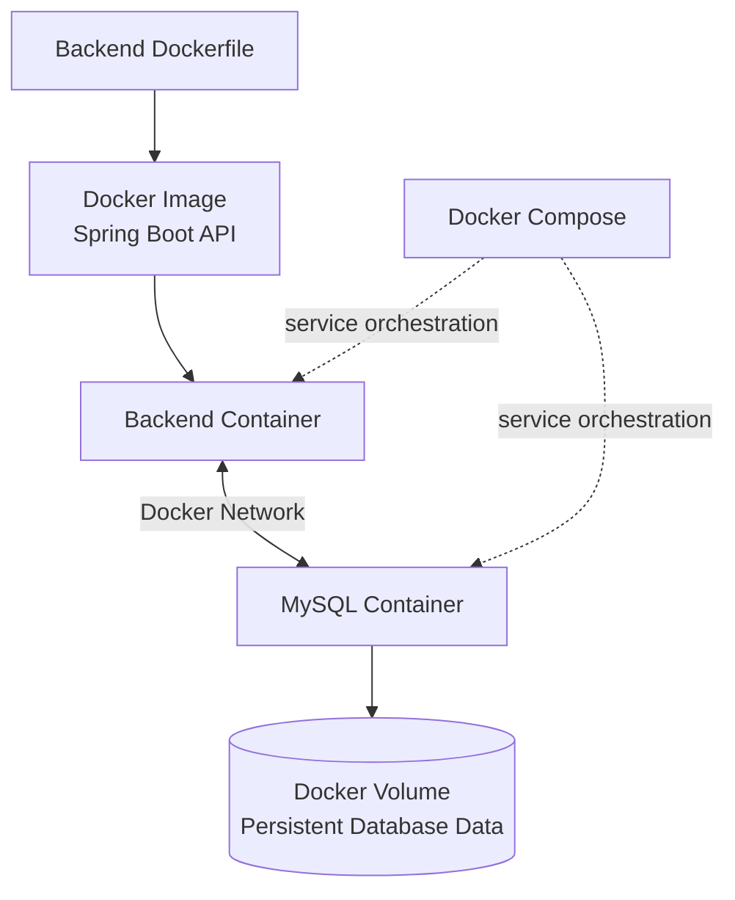
📦 Backend Image: Multi-Stage Build
The backend image is built from the Spring Boot Maven project.

A multi-stage Docker build separates the build environment from the runtime environment:
1. Build stage — uses Maven with Java 21 to resolve dependencies, compile the source code and package the application as a JAR.
2. Runtime stage — runs the generated JAR using a Java runtime image, without carrying the full Maven build environment into the final application image.
This approach keeps build-time tooling separate from the runtime image and can reduce the final image size.

Build the backend image from the directory containing the backend Dockerfile:
docker build -t smart-parking-backend .
Check that the image was created:
docker images
🐬 MySQL Container
MySQL uses the official mysql:8 image. A separate custom Dockerfile is not required for the database because the official image already provides the MySQL server environment.

The database used by this project is:
Database: smart_parkingdb
The MySQL container is kept separate from the Spring Boot backend container. This separation allows the database and application to be managed independently.
🌐 Docker Network
A Docker network enables the backend container and MySQL container to communicate with each other.

Inside a Docker network, containers can communicate using their service/container names rather than relying on localhost.

Why this matters: localhost inside the backend container refers to the backend container itself, not to the MySQL container. The database connection must therefore use the MySQL service/container hostname configured in the Docker setup.
💾 Docker Volume
A Docker volume is used for persistent MySQL storage.

Without a volume, database files stored only in a container's writable layer may be lost when that container is removed. A named volume keeps database data separate from the lifecycle of the MySQL container.
MySQL Container
      |
      v
Docker Volume
      |
      v
Persistent Database Files
The volume allows the database container to be recreated while retaining the data stored in the volume. Removing a container and deleting its volume are different operations; deleting the volume removes the persisted database data.
⚙️ Docker Compose
Docker Compose is used to define and manage the backend and MySQL services together from a Compose configuration file.

It helps coordinate:
- Backend and MySQL service definitions.
- Image builds and container creation.
- Environment-based configuration.
- Container networking.
- Persistent database volume configuration.
- Starting and stopping the services as one application stack.
Common lifecycle commands, executed from the directory containing the Compose file:
# Build images if required and start services in the background
docker compose up --build -d

# Check running containers
docker compose ps

# View service logs
docker compose logs

# Follow logs continuously
docker compose logs -f

# Stop and remove the Compose containers and network
docker compose down
[!IMPORTANT]
docker compose down does not remove named volumes by default. Avoid adding --volumes / -v unless you intentionally want to delete the persisted MySQL data.

🔐 Configuration & Secrets
Database credentials and the JWT secret should be supplied through environment variables rather than committed as real values in the repository.

Use the environment variable names expected by the application's configuration:
DB_USERNAME=your_database_username
DB_PASSWORD=your_database_password
JWT_SECRET=your_long_secure_jwt_secret
Keep real credentials out of Git. Use strong secrets for deployed environments and provide the database connection settings required by the container network.
🧪 Useful Docker Commands
Command	Purpose
docker images	List locally available images
docker ps	List running containers
docker ps -a	List all containers, including stopped ones
docker logs <container>	Read a container's logs
docker exec -it <container> sh	Open a shell inside a running container, if available
docker volume ls	List Docker volumes
docker network ls	List Docker networks
docker compose ps	Check Compose service status
docker compose down	Stop and remove Compose-managed containers and network


✅ What Dockerization Adds to This Project
- A repeatable container-based runtime for the Spring Boot backend.
- Separation between the backend application and the MySQL database.
- A dedicated network for backend-to-database communication.
- Persistent database storage through a Docker volume.
- Centralized service management through Docker Compose.
- Less dependence on the host machine's locally installed runtime and database setup.
🔮 Roadmap
- [ ] 💳 Payment gateway integration
- [ ] 🔔 Email / SMS notifications
🎓 What This Project Demonstrates
Beyond basic CRUD, this backend covers:

RESTful API design · Layered architecture · Spring Security with JWT & RBAC · JPA/Hibernate relationships · Transaction management · Pessimistic locking · DTO design with MapStruct · Bean validation · Global exception handling · Dynamic pricing · Booking lifecycle management · Pagination & sorting · Business analytics

The focus is on understanding the real backend request flow: business rules, security, persistence, transactions and concurrency.
👨‍💻 Author
<div align="center">Sahid Anwar
Java Backend Developer · Spring Boot Developer


Built with ☕ Java + Spring Boot + persistence + security + a lot of debugging.
🚗 Smart Parking System — Find. Book. Park.
⭐ If you find this project useful, consider starring the repository.
</div>
